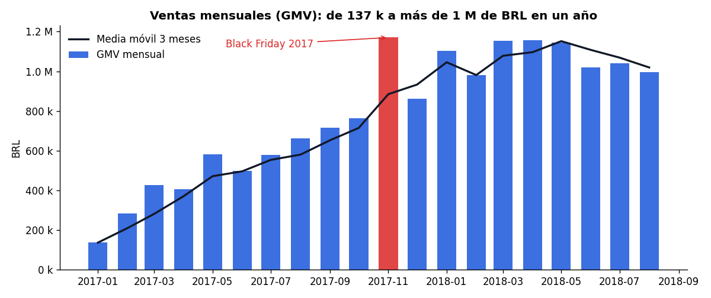
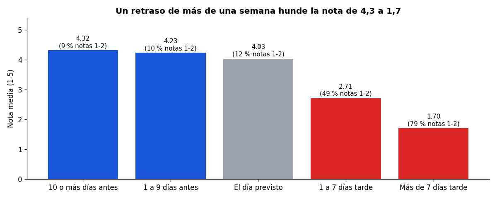
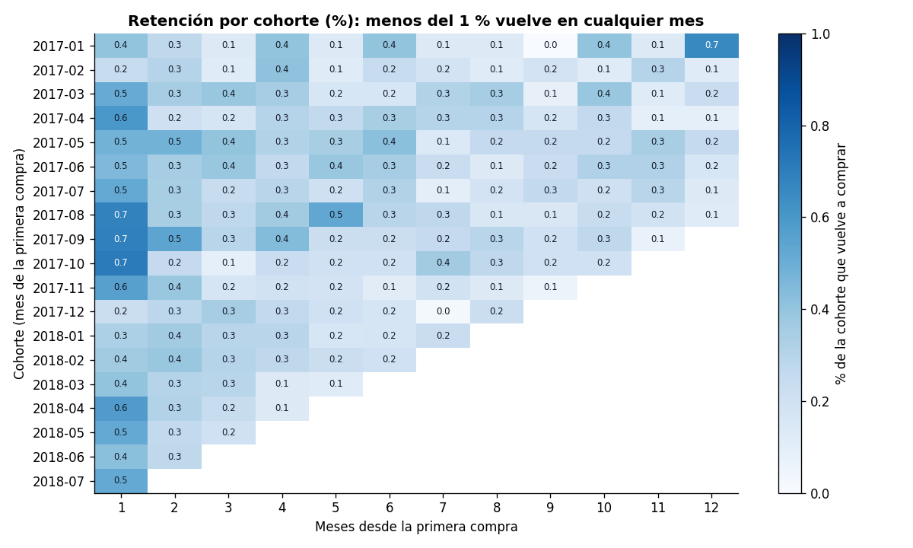
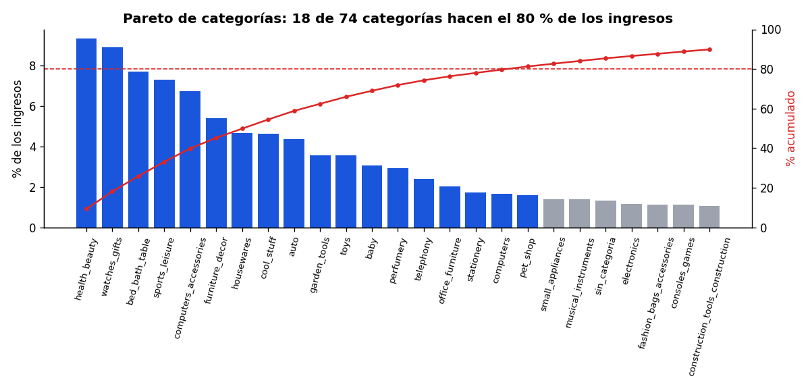
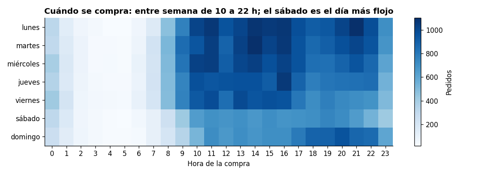

# Olist en SQL — análisis de un e-commerce real

**11 consultas SQL que responden preguntas de negocio sobre 97.905 pedidos reales de Olist, el mayor marketplace de Brasil.**

[](https://github.com/alvarodc093-pixel/Olist-SQL-Analysis/actions/workflows/ci.yml)   



## En resumen

- **Problema:** un marketplace crece rápido, pero ¿de dónde sale el crecimiento y qué lo frena? Respondo con SQL a lo que preguntaría un equipo de negocio: ventas, categorías, retención, logística, vendedores y pagos.
- **Datos:** el [dataset público de Olist](https://www.kaggle.com/datasets/olistbr/brazilian-ecommerce) (8 tablas relacionadas, ~100 k pedidos de 2016 a 2018). Analizo los 20 meses completos, de enero de 2017 a agosto de 2018.
- **SQL:** CTEs, funciones de ventana (`LAG`, `LEAD`, `RANK`, `NTILE`, `ROW_NUMBER`, `FIRST_VALUE`, sumas acumuladas y medias móviles), cohortes, agregación condicional (`FILTER`, `CASE`), `PERCENTILE_CONT` y comprobaciones de calidad de datos.
- **Resultado:** el problema no es captar clientes, es **que no vuelven** (solo el 3 % repite) y **los retrasos**, que hunden la nota de 4,3 a 1,7.

## Hallazgos principales

| # | Pregunta | Respuesta corta | Consulta |
|---|---|---|---|
| 1 | ¿Cómo evolucionan las ventas? | De 137 k BRL en enero de 2017 a más de 1 M al mes en 2018. De enero a agosto, 2018 vende un **140 % más** que 2017. Ticket medio estable: **~160 BRL**. | [02](sql/02_kpis_mensuales.sql) |
| 2 | ¿Qué categorías concentran las ventas? | **18 de 74 categorías** hacen el 80 % de los ingresos. Lideran salud y belleza, relojes y regalos, y cama, mesa y baño. | [03](sql/03_categorias_pareto.sql) |
| 3 | ¿Vuelven los clientes? | Menos del **0,5 %** de cada cohorte compra en el mes siguiente. Solo el **3 %** de los clientes repite y aporta el 5,7 % de las ventas. | [04](sql/04_cohortes_retencion.sql), [05](sql/05_recompra.sql) |
| 4 | ¿Cuánto pesa un retraso en la nota? | Llegar antes de tiempo: nota **4,32**. Llegar más de 7 días tarde: **1,70** y el 79 % de notas son de 1 o 2 estrellas. El 6,7 % de los pedidos llega tarde. | [06](sql/06_entregas_vs_reviews.sql) |
| 5 | ¿Dependemos de pocos vendedores? | El **25 % de los vendedores genera el 87 %** de los ingresos, y su nota es igual que la del resto (4,09 frente a 4,14). | [07](sql/07_vendedores.sql) |
| 6 | ¿Dónde falla la logística? | São Paulo concentra el 42 % de los pedidos y recibe en 8,7 días. Los estados del norte tardan de 20 a 30 días y pagan un flete de ~20 % del pedido. **Río de Janeiro** es el punto débil con más volumen: 13 % de los pedidos, 12 % de retrasos y nota 3,91. | [08](sql/08_geografia.sql) |
| 7 | ¿Cómo se paga? | Tarjeta en el 75 % de los pedidos. Los que pagan en 6 o más cuotas gastan **3 veces más** (304 frente a 101 BRL). El *boleto* (pago en efectivo) supone el 20 %. | [09](sql/09_pagos.sql) |
| 8 | ¿Cuándo se compra? | De lunes a miércoles, de 10 a 22 h. El sábado es el día más flojo. | [10](sql/10_estacionalidad.sql) |
| 9 | ¿Hay días anómalos? | El Black Friday de 2017 (24-nov) tuvo **1.166 pedidos, 7 veces la media** de los 28 días anteriores. El siguiente día más anómalo, la víspera, se queda en 1,7 veces. | [11](sql/11_dias_pico.sql) |



## Recomendaciones de negocio

1. **Retención antes que captación.** Con un 97 % de clientes de una sola compra, cada punto de recompra vale mucho: emails post-entrega, cupón para el segundo pedido y seguimiento de la recompra a 90 días como KPI.
2. **Proteger el plazo prometido.** Más de una semana de retraso convierte una nota de 4 estrellas en una de 1 a 2. Conviene dar fechas estimadas más realistas en Río de Janeiro y el nordeste, y avisar al cliente antes de que el retraso ocurra.
3. **Cuidar a los grandes vendedores.** Uno de cada cuatro vendedores aporta el 87 % de las ventas: necesitan un gestor de cuenta y alertas si su volumen cae.
4. **Usar las cuotas como palanca en categorías caras.** Los clientes que pagan a plazos compran pedidos tres veces más grandes.
5. **Preparar el Black Friday.** Un solo día multiplica por 7 los pedidos: hay que reforzar stock, vendedores y transporte para que el pico no acabe en retrasos.

## Cómo está montado

```text
.
├── sql/
│   ├── 00_modelo.sql               # modelo en estrella a partir de los CSV
│   ├── 01_calidad_datos.sql        # 13 comprobaciones antes de analizar
│   ├── 02_kpis_mensuales.sql       # ventas, pedidos, ticket, variación mensual e interanual
│   ├── 03_categorias_pareto.sql    # Pareto y clasificación ABC
│   ├── 04_cohortes_retencion.sql   # retención por cohorte mensual
│   ├── 05_recompra.sql             # clientes recurrentes y tiempo hasta la 2.ª compra
│   ├── 06_entregas_vs_reviews.sql  # retraso frente a nota
│   ├── 07_vendedores.sql           # concentración por cuartiles de vendedor
│   ├── 08_geografia.sql            # estados: plazos, flete y nota
│   ├── 09_pagos.sql                # métodos de pago y cuotas
│   ├── 10_estacionalidad.sql       # día de la semana x hora
│   └── 11_dias_pico.sql            # días anómalos con z-score móvil
├── results/                        # el resultado de cada consulta en CSV
├── docs/img/                       # gráficos del README
├── tests/
│   ├── test_logica_sql.py          # mini dataset hecho a mano con resultados conocidos
│   └── test_datos_reales.py        # las consultas cuadran entre sí con los datos reales
├── descargar_datos.py              # baja el dataset de Kaggle (sin cuenta)
├── ejecutar.py                     # crea la base DuckDB y ejecuta todas las consultas
└── graficos.py                     # genera los gráficos desde results/
```

**Por qué DuckDB:** es una base de datos analítica que funciona sin servidor, lee los CSV directamente y usa SQL estándar. Las consultas se pueden llevar a PostgreSQL, BigQuery o Snowflake casi sin cambios: solo varían algunas funciones de fecha (`DATE_DIFF`, `DATE_TRUNC`).

### El modelo de datos

```text
             dim_clientes          dim_productos         dim_vendedores
                  │                      │                      │
                  ▼                      ▼                      ▼
   fct_pedidos (1 fila por pedido) ◄── fct_items (1 fila por producto vendido)
        ▲          ▲
   fct_pagos   fct_reviews

   pedidos_analisis = fct_pedidos sin cancelados, sin pedidos vacíos y en 2017-01..2018-08
```

Todas las consultas parten de `pedidos_analisis`, así que los totales cuadran entre ellas, y hay tests que lo comprueban.

### Decisiones y trampas evitadas

- **Clientes reales:** Olist crea un `customer_id` nuevo en cada pedido. Si se cuentan esos ids, hay 99.441 "clientes"; los clientes reales (`customer_unique_id`) son 96.096. Sin este cambio, la retención saldría 0.
- **Fan-out:** unir items y pagos sin agregar da 117.601 filas y duplica importes. Por eso agrego cada tabla por pedido antes de unirlas.
- **Reviews duplicadas:** 547 pedidos tienen más de una review. Me quedo con la última.
- **GMV = productos + flete.** El importe pagado difiere en 1.021 pedidos por vales e intereses de cuotas.
- **Meses incompletos fuera:** 2016 y septiembre-octubre de 2018 tienen muy pocos pedidos y distorsionarían las tendencias.

Las 13 comprobaciones están en [01_calidad_datos.sql](sql/01_calidad_datos.sql) y su resultado en [results/01_calidad_datos.csv](results/01_calidad_datos.csv).

### Un ejemplo: retención por cohorte

```sql
WITH actividad AS (
    SELECT DISTINCT
        customer_unique_id,
        mes,
        MIN(mes) OVER (PARTITION BY customer_unique_id) AS cohorte
    FROM pedidos_analisis
),
por_cohorte AS (
    SELECT cohorte,
           DATE_DIFF('month', cohorte, mes)   AS mes_n,
           COUNT(DISTINCT customer_unique_id) AS clientes_activos
    FROM actividad
    GROUP BY cohorte, DATE_DIFF('month', cohorte, mes)
)
SELECT cohorte, mes_n, clientes_activos,
       ROUND(100.0 * clientes_activos / FIRST_VALUE(clientes_activos) OVER (
           PARTITION BY cohorte ORDER BY mes_n), 2) AS retencion_pct
FROM por_cohorte;
```



## Más gráficos





## Cómo ejecutarlo

```bash
pip install -r requirements.txt
python descargar_datos.py   # ~45 MB desde Kaggle, sin cuenta
python ejecutar.py          # crea data/olist.duckdb y guarda results/*.csv
python graficos.py          # regenera docs/img/
pytest -q                   # 20 tests
```

Para explorar los datos a mano: `duckdb data/olist.duckdb` y, por ejemplo, `SELECT * FROM pedidos_analisis LIMIT 10;`.

**Tests:** `test_logica_sql.py` ejecuta las consultas sobre un mini dataset de 5 pedidos cuyo resultado se calcula de cabeza (cancelados excluidos, fan-out, review duplicada, cohortes, recompra, método de pago principal). `test_datos_reales.py` comprueba con los datos reales que el total de pedidos y ventas es el mismo visto por mes, por categoría, por estado y por hora. El CI de GitHub Actions descarga el dataset y ejecuta ambos en cada push.

## Limitaciones

- Los datos terminan en 2018. Sirven para practicar el análisis, no para describir a Olist hoy.
- La review es del pedido, no del producto ni del vendedor. Si un pedido tiene varios vendedores (menos del 2 %), la nota cuenta para todos.
- La "recompra el mismo día" (el 30 % de las segundas compras) seguramente son pedidos partidos, así que la fidelidad real es todavía menor que el 3 %.
- Las horas están en la hora local que registra Olist, sin ajustar por zona horaria de cada estado.

## English summary

SQL analysis of ~98k real orders from Olist, Brazil's largest marketplace, using DuckDB. It includes a star-schema model, 13 data-quality checks, monthly KPIs with MoM/YoY growth, Pareto/ABC by category, cohort retention, repeat-purchase analysis, delivery delay vs review score, seller concentration (NTILE), regional logistics, payment behaviour and anomaly detection with a rolling z-score. Key findings: only 3 % of customers buy again, late deliveries (over 7 days) drop the average score from 4.3 to 1.7, and the top 25 % of sellers drive 87 % of revenue. Twenty tests check the SQL logic on a hand-made fixture and the consistency of totals across queries on the real data.

---

Datos: [Brazilian E-Commerce Public Dataset by Olist](https://www.kaggle.com/datasets/olistbr/brazilian-ecommerce), licencia CC BY-NC-SA 4.0. Los CSV no se incluyen en el repositorio; `descargar_datos.py` los descarga.
